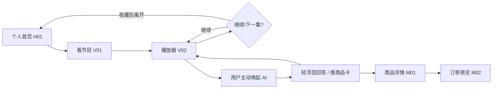
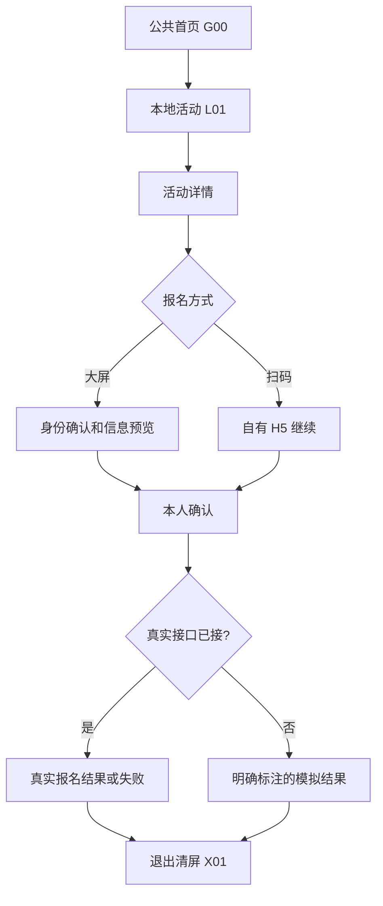

# 闺蜜机｜信息架构与关键交互 V0.1

> 2026-10-15 · **低保真产品设计提案，未获视觉或开发验收**  
> 上游：[产品功能 V0.1](../product/elder-companion-v0.1.md) / [功能评审与原型裁剪 V0.2](../product/elder-companion-functional-review-v0.2.md)  
> 本文描述**用户看到什么、在哪里找得到、点击后发生什么**。不定义品牌 UI 视觉、生产接口或量产硬件尺寸。

## 1. 导航原则

1. **内容优先于 AI 形象**：开机第一眼是可以直接看、玩、找服务的内容，AI 伙伴始终可主动唤起但不占满首页。
2. **不强迫使用语音**：看剧、报名、领券、买东西均有触摸完成路径；私人设备可自选语音唤醒。
3. **大屏能办完事**：报名、查看订单预览可在个人设备上完成；公共设备在触及身份/付款时可扫码续办。
4. **不挤满菜单**：稳定五个一级目的地 + “我的”/账户入口 + 全局 AI；8 个功能域可以跨越一级目的地，不逐一变成 Tab。
5. **节目连续性优先**：AI 轻浮层不导致播放器销毁，返回时能准确续播，除非用户明确退出或进入沉浸式会话。
6. **内容分发两层**：游客按**设备绑定的网格**看内容；个人登录后再叠加兴趣和会员状态，不自动因场地变化改写个人记忆。
7. **商业与个人隐私分隔**：带货/赞助/福利清晰标识，不以健康焦虑、私人心事或情感依恋做隐性推销。

## 2. 五个主目的地 + 两个常驻入口

| 一级目的地 | 首屏提供 | 第二层主要去向 | 入口标识 |
| --- | --- | --- | --- |
| **首页** H01 | 继续观看、热点内容、所在网格活动/福利、最近作品与老友动态 | 节目、活动、商品、创作、收藏 | 内容聚合 |
| **看节目** V01 | 免费短剧为主，兼容戏曲/老歌/新闻/健身视频；频道、搜索、收藏 | 播放器 V02、收藏、追剧 | 连续娱乐 |
| **AI 趣玩** C01 | 写真/回忆录/书画/才艺，今日主题，近期作品 | 素材选择、真实生成、作品 C02 | 自我表达 |
| **本地生活** L01 | 活动、讲座、课程、福利、场地服务、健康科普入口 | 活动详情、报名 L02、数字人课程 E01、领券 | 线下与服务 |
| **商城** M01 | 会员权益、精选商品、店铺、服务分类、购物车 | 店铺、商品、订单确认 M02 | 交易 |
| **常驻：我的** P01 | 用户/会员、历史、作品、老友、家人分享、订单、个人偏好 | P02 人格与记忆、管理/隐私设置 | 账户（公共机不展示私人数据） |
| **常驻：AI 伙伴** A01 | 小浮层问答和服务命令，可转全屏私人聊天/RP | AI 比价、查活动、课程答疑、角色世界 | 浮动/侧边入口，公共机为通用助手 |

**重要**：“老友与亲情”不是被删掉；它出现在首页的朋友动态、作品详情、我的联系人与分享流程。健康生活和课程从“本地生活/看节目”按内容形式自然进入。首页不是仅有六个机械大按钮。

## 3. 导航树

```text
设备入口
├── 个人专用设备 → H01 首页
│   ├── 看节目 V01 → V02 播放器 → 续播/收藏/关联服务
│   ├── AI 趣玩 C01 → 素材/授权 → C02 作品结果 → 我的作品/主动分享
│   ├── 本地生活 L01 → 活动详情 → L02 报名确认/结果
│   │                         └── E01 数字人课程 → 换讲师/声线/提问
│   ├── 商城 M01 → 店铺/商品 → M02 购物车/订单确认
│   ├── 我的 P01 → 作品/收藏/老友/亲情/订单/会员
│   │              └── P02 私人人格与记忆/隐私设置
│   └── 全局 AI A01 → 轻浮层 → {办事页结果卡 / 沉浸式聊天/RP}
└── 公共服务设备 → G00 公共首页
    ├── 看节目（不保留跨客人的追剧记录）
    ├── 本地活动/福利 → 大屏报名身份确认 OR 自有 H5 扫码续办
    ├── 趣味 AI 临时体验 → 授权处理 → 作品取回码/清屏
    ├── 商城浏览 → 涉及身份或订单时扫码自有 H5 续办
    ├── 课程浏览/公共服务 AI（不得加载个人记忆）
    └── X01 结束体验/超时清理 → G00
```

### 硬件布局适配（[设计建议]）

- 先用**布局体系**，不把 21.5—32 英寸写成已确认具体硬件。宽屏候选：左侧窄导航 + 右侧内容区；竖屏候选：底部/侧边紧凑导航 + 纵向滚动内容。
- 所有触控入口具备足够点击面积；正文、字幕、音量、播报速度可调，不靠色彩单独表达选中态。
- 公共设备显著显示“公共体验”和“结束并清除”；个人设备显著显示当前账号和 AI 录音/唤醒状态。
- 不使用仅靠悬停、手势暗语或细小图标才能完成的关键任务。

## 4. 页面级功能与状态（用于低保真验收）

### H01 个人首页

**默认内容排序提案**：A. 继续观看（优先，已有进度时） / 今日精选（首次使用时）→ B. 免费看剧横向推荐 → C. 本地活动与福利 → D. AI 趣玩推荐/最近作品 → E. 老友近况 → F. 商城精选和会员权益。全局 AI 入口不占据整个首页。

**交互**：点击继续看直达 V02 原进度；点击活动直达详情；内容卡进入对应入口，不出现没有响应的展示卡。未登录时隐藏个人历史，替换为“本地热门”。

**状态**：新用户 / 有续播 / 内容加载中 / 无活动 / 离线。推荐内容可以用样本数据，但必须标记。

### V01 看节目 · V02 播放器

频道：[短剧] [戏曲老歌] [新闻时事] [舞蹈跟练] [收藏]；筛选和搜索是二级工具，短剧作为第一默认频道。

播放器至少显示：片名、分集/进度、暂停/播放、上下集、字幕/音量、返回、收藏。连续播放下一集由用户控制，允许关闭连播；插入广告清晰显示“广告/赞助”，不遮盖关键控制。

用户唤起 AI：
- 简短查问 → 播放器上轻浮层，内容状态保留，提供“暂停视频再听我说”。
- 转入沉浸式对话/RP → 暂停播放器，返回后询问/自动恢复到原进度（以可预测的 UI 为准）。
- 业务推荐来自**用户主动提问或自愿点击**，不自动弹出商品打断追剧。

状态：缺资源/视频无权播放/网络中断/未登录收藏/下一集不存在。严禁把模拟视频当成已授权内容播出。

### A01 AI 伙伴：一个入口，两种界面深度

**轻模式**：保留原业务上下文，如“正在看第12集”；侧边对话卡、语音状态、工具执行状态、推荐对象卡片。查看实际来源或商品详情时能直接打开对应页面。

**深模式**：全屏私人聊天/私人 RP、数字人课程，明确当前角色、声线、隐私模式；允许退出返回先前任务。数字人不主动开话题；只有被点击或唤醒后才响应。

**行动状态**：
```text
待命 → 理解需求 → 查询平台数据 → 结果卡 → 草稿/操作预览
                                             ↓
                                         人工确认
                                            ↓
                                   执行（若已接业务接口）
                                            ↓
                                真实回执 / 明确失败 / 未接入演示提示
```
AI 不能替用户点确认，不能根据 RP 虚构内容决定购买。未经许可不得复制声音或真人外貌。

### C01 AI 趣玩 · C02 作品结果

主题优先：AI 写真（演示优先 PoC）、人生故事、书法展示、才艺/唱歌。素材来源：拍摄（样机支持时）、本地上传、文字/语音描述。

设计流：选主题→输入/授权素材→预览生成状态（可取消）→生成结果→[重新生成][保留私密][主动分享][关联制作服务]。

保存为私密是默认；只有明确选择分享范围后才向朋友或家庭发布。公共体验默认暂存，不将游客照片留到下一位用户；可通过扫码取回或手动结束清除。

### L01 本地生活 · L02 活动/福利

同一入口区分 [活动] [福利] [课程] [健康科普]；每个卡片必须显示本网格适用范围、活动时间地点、免费/价格、剩余名额（只有来源可靠时）、提供方与报名/领取条件。

详情底部操作：[大屏报名] [手机扫码报名]。大屏提交前显示确认摘要；公共机需先识别用户或临时扫码继承；私人设备允许直接使用当前账户（仍需提交确认）。

状态：名额已满、已报名、活动取消、定位网格无供给、重复领券、扫码超时和失败。领取/核销必须展示服务商提供的真实状态；未接入时明确标注样本演示。

### M01 商城 · M02 订单确认

商城提供：[平台精选] [入驻店铺] [生活商品] [作品制作] [本地服务] [会员权益]；用户看得到**卖家是谁**，不做外部服务商跳转式导流。

商品详情：规格/单位价/运费/可达区域/履约方/预计送达或服务条件/售后。AI 推荐结果回流到同一商品详情，而不是复制一套“AI 商品页”。

购物车/订单预览固定展示：商家、商品、数量、含运费总价、地址/服务地点、优惠、用户确认。真实支付只在 S3 获得业务接口和权限后执行；S1 演示按钮改为“模拟提交/查看订单示例”，禁止误导。

### E01 数字人课程

课程详情→选择 [讲师形象] [声线] [语速] [风格简选] → 开始讲课 → 暂停/提问/重新解释 → 返回课程。

知识内容与可变人物呈现分离：先证明**同内容两种人设/声音**，有余力再验证实时提问。RP 角色剧情不写入现实档案。数字人画面和声音须标识 AI 合成与合法授权。

### P01 我的 · P02 人格/隐私

“我的”包含：追剧历史、我的作品、我的收藏、报名记录、购物订单、会员权益、老友/亲情联系人。**亲情不是家庭监控后台**，子女只能看到老人主动分享的项目。

“人格与记忆”包含：当前私人角色、角色世界、声线、可选唤醒词、记忆分层授权、查看/修改/删除/导出、关闭语音唤醒。公共设备没有这个入口。

## 5. 五条核心可点击流程（验收用）

### WF01｜一个人连续免费看剧（主留存）



验收：模拟半小时观看路径不需要频繁退出；AI 介入、购买浏览后能返回原剧集进度。

### WF02｜公共机活动报名（双入口）



验收：两条路径有等价语义的报名对象，公共机离场不保留用户姓名/联系电话。

### WF03｜私人 AI 帮忙购物

```text
唤起 AI → “找便宜的洗衣液” → 平台真实/样本目录结果
→ 比较 2—3 个商品（规格、店铺、运费）→ 打开商品卡 → 加购物车
→ 订单信息预览 → 本人确认 → [S1：模拟结果｜S3：真实接口回执]
```

验收：AI 不越权支付，不编造库存/商家，反复取消不会产生订单。

### WF04｜AI 创作、老友/家庭分享

```text
AI 趣玩 → 选择写真主题 → 摄像头/上传授权 → 输出作品
→ 重新生成/私密保存 → 选择分享对象（默认无） → 本人确认
→ 指定老友/家人收到可见作品 → 对方点评或代付作品制作服务
```

验收：支付方不因此获得其它私人作品与聊天记录。

### WF05｜自选人设的数字人课程

```text
本地生活/课程 → 一节历史课 → 选讲师A与声线A → 课程播放
→ 暂停/简单提问 → 换讲师B与声线B → 同课程同知识 → 返回
```

验收：允许有限讲解风格变化，但不偷偷重写专业课程事实；非实时效果必须标注。

## 6. 重要异常和任务恢复规则

| 场景 | 正确的产品反馈 |
| --- | --- |
| 断网或 AI 超时 | 停止“思考中”，明确说明无法完成、保留草稿和重试入口 |
| 未购买的商品已缺货 | 在订单确认前重新校验；不沿用过期价格强制成交 |
| 活动取消或名额满 | 明确无法报名，返回同网格可替代活动；不显示虚假报名成功 |
| 生成图片被用户拒绝/取消 | 不分享；允许重新生成；公共设备清除暂存 |
| 课程无法在线换声线 | 使用合法预生成声线的演示效果，并说明非实时 |
| 公共设备中途离开 | 空闲超时返回 G00、删除临时文件、停麦克风/摄像头 |
| 家人尝试进入私人记忆 | 无授权入口；不能通过“我为你付了钱”来绕过 |
| AI 弹层盖住播放器控制 | 弹层避让控制区，可收起，视频状态保持稳定 |
| 广告主推高价健康品 | 营销标识、资质审核，不基于私密健康焦虑做引导 |

## 7. 交互稿输出要求

1. 设计稿覆盖 16 个页面/状态标识中的主要 12 个（见功能评审），**不按页面数量虚构开发量**。
2. 每个 P0 页面至少有：正常、空、加载、失败（必要时确认）状态。
3. 低保真优先使用几何块、文字和标准组件；除用户授权照片等真实 PoC 输入外，不需设计昂贵插画素材。
4. 同一数据模型支撑 AI 入口和手动操作，例如同一个活动/商品详情，不重复造数据来源。
5. 横竖屏都必须在到货设备规格明确前保留可调整结构；不能用手机布局机械放大到大屏。
6. 交付顺序：**H01→V02→A01→M02→G00→L02→C02→E01→P02**，先体验结构，再视觉风格，再交互式原型。

## 8. 本轮尚未拍板的设计建议

- 五个主目的地及排序尚属于 **IA 提案**，不是用户最终 sign-off。
- 个人设备是否支持多人切换、耳机、蓝牙外设、横/竖屏以样机约束复核。
- 首页“老友近况”的推荐逻辑、实际内容供给与商业赞助排序需要独立规则评审。
- 自有手机 H5 的具体注册、身份验证、扫码会话凭证及支付能力由后续设计定义。
- 静态数字人与实时数字人方案须做 PoC 才能选定；无法验证则保持“概念演示”标识。

**下一步**：先审核本文的一级导航和 WF01/WF02/WF03 低保真逻辑；无产品异议后再做可点击的视觉/交互草图，而不是直接启动生产开发。
